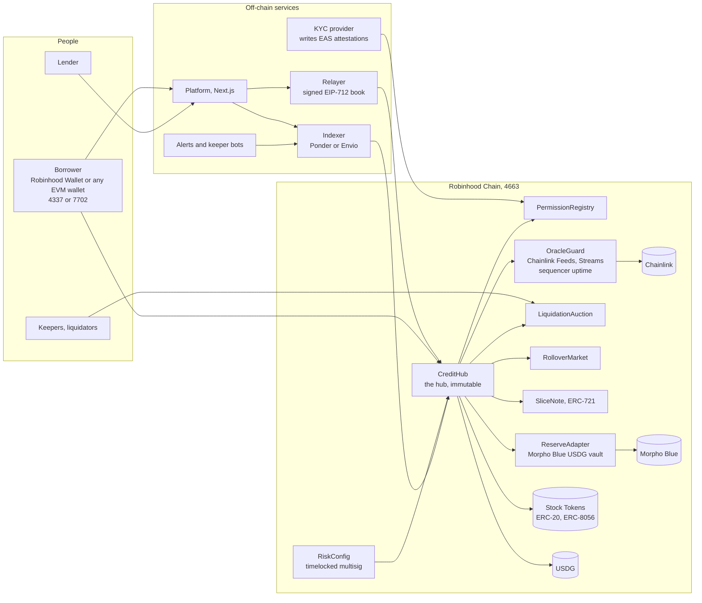

# How the pieces connect

Spatial is built in two layers. At the bottom sits a small group of non-upgradeable contracts deployed to chain ID 4663, Robinhood Chain. Around them runs a set of open-source services, and any operator can host each one. Balances and rules belong to the contracts and nowhere else. The services exist to make on-chain state quicker to query and simpler to act upon. A useful picture is mission control: it observes and passes messages along, yet the vehicle is never under its command.

## Trust, item by item

The full set of trust assumptions fits in five points.

* **Chainlink supplies every price.** No contract consumes a price until `OracleGuard` has run its checks and accepted it.
* **Registered attestation issuers decide eligibility.** The list of issuers lives in `RiskConfig`. A statement from an issuer about a wallet is the single input the contracts take on faith.
* **The timelocked multisig changes parameters, and only parameters.** It has no route to user funds, no way to swap out code, and no means of blocking a borrower who wants to repay.
* **Nothing depends on the relayer behaving.** Each offer is checked afresh on-chain by the hub when a loan originates. A malicious relayer could withhold offers, but it cannot fabricate or alter one.
* **Nothing depends on the platform behaving either.** All it does is display public data and call public contracts.

## How to read the arrows

Each arrow stands for a call or a flow of data. Borrowers have two paths into the hub: via the platform and the relayer, or directly from their own wallet. A lender's only action is signing, and either the relayer or the borrower brings that signature on-chain. Keepers interact with `LiquidationAuction` rather than the hub, since the hub takes liquidation hooks from the auction contracts and from no one else. Roles come to the hub from `PermissionRegistry`, prices from `OracleGuard`, and every adjustable setting from `RiskConfig`. The hub mints slice tokens through `SliceNote`, holds Stock Tokens in escrow, transfers USDG and, for lenders who opted to keep idle capital in reserve, pulls funds from the Morpho vault via `ReserveAdapter`. The indexer consumes events and nothing more, and the keeper bots take their view from the indexer.

## On-chain contracts

| Contract | Responsible for |
| --- | --- |
| `CreditHub` | Checking offers, holding collateral, paying out principal, keeping the ledger of loans and slices, handling repayment |
| `QuoteBook` | EIP-712 hashes, recovering ECDSA and EIP-1271 signers, nonce bitmaps, tracking partial fills |
| `PermissionRegistry` | Converting attestations into plain yes or no role checks, after applying expiry and jurisdiction rules |
| `OracleGuard` | Prices that know the trading session, protected against stale data, pauses, multipliers and a sequencer that is down |
| `LiquidationAuction` | The Dutch sale of seized collateral, payment in kind when a lender opted for it, and division of the penalty |
| `RolloverMarket` | At maturity, an auction with a climbing rate that moves the loan into a fresh term |
| `SliceNote` | An ERC-721 token for each lender slice; it can move only to a recipient who is eligible |
| `ReserveAdapter` | Places lender USDG in a single whitelisted Morpho vault and withdraws it when a fill calls for it |
| `RiskConfig` | Every tunable parameter, controlled by the timelocked multisig, with an event emitted on each write |
| `FeeVault` | Receives fees on origination, the interest share, penalties and rollovers |

For the functions behind each contract and the interfaces integrators use, read [The contract set](contracts.md).

## Off-chain services

| Service | Role |
| --- | --- |
| Relayer | Validates and publishes signed offers and borrow requests, then suggests matches |
| Indexer | Reconstructs every loan, slice, auction and parameter from emitted events, serving the Explorer and the bots |
| Keepers | Send alerts, kick off auctions, rebalance reserve capital, post rollover acceptances |
| KYC service | Screens identity, sanctions and residency before writing the attestation; personal data stays off-chain |
| Platform | Dashboards for borrowers and lenders, plus the Explorer, Telemetry and the governance log |

Each service gets a fuller treatment in [Off-chain services](services.md).

## Operating rules

* No contract is ever upgraded where it stands. A new version means a new deployment, and every open loan finishes its life on the deployment where it began.
* Loan records aside, the only mutable state is the parameter set in `RiskConfig`. Any change sits through the timelock first and is then published on-chain as an event.
* The emergency pause covers exactly two actions: opening loans and liquidating them. Repayment, and reclaiming collateral once a loan is repaid, can never be paused.
