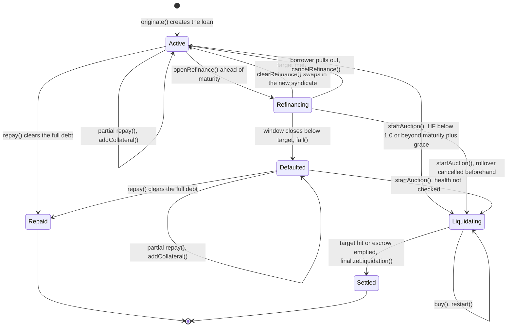
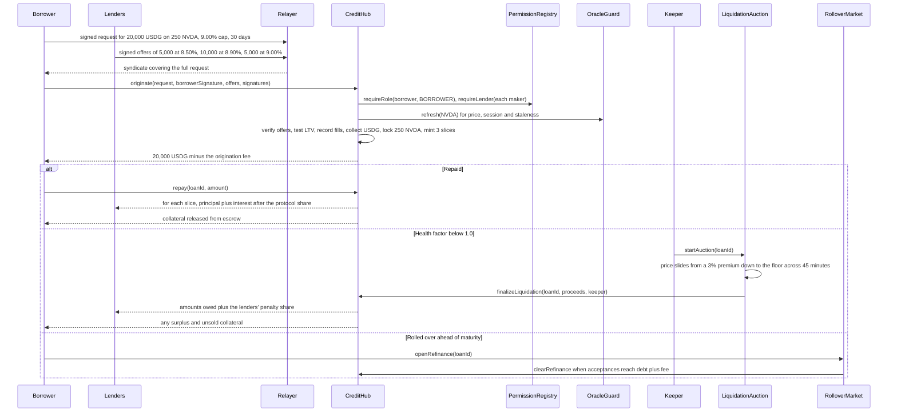

# Loan states

For each loan the hub keeps a `LoanStatus`. Apart from `None`, which signals that the loan does not exist, six values are possible, namely `Active`, `Refinancing`, `Defaulted`, `Liquidating`, `Settled` and `Repaid`. At any moment a loan has exactly one. A single transaction performs each transition and a single event reports it, which means the chain alone is enough to reconstruct everything that happened to a loan. In the Explorer that reconstruction is the flight log, listing one loan's events in sequence with a Blockscout link for each.

## The stage before a loan exists

Until it is filled, a borrow request is only a signed message held in the relayer book. No collateral is locked and nothing has been written on chain. It can lapse in two ways without ever becoming a loan:

* Its launch window, meaning the fill deadline, runs out. After that `originate` refuses it with `RequestExpired`, and any offers aimed at its hash have nothing left to fill.
* The borrower calls `cancelRequest`, which consumes the digest so that no relayer can submit it afterwards. The event is `RequestCancelled`.

Filling consumes that same digest, so one request can fund no more than a single loan.

## Transitions

## The six statuses explained

| Status        | Can it be repaid? | What is going on                                                                                                                                                                  |
| ------------- | ----------------- | --------------------------------------------------------------------------------------------------------------------------------------------------------------------------------- |
| `Active`      | Yes               | The collateral sits in escrow, the borrower has the principal and all slices are earning interest. This status covers the whole term plus the 24-hour grace window once maturity passes, and any period after that until an auction starts. |
| `Refinancing` | No                | A rollover auction is live. The existing slices go on accruing until the target is funded by incoming lenders or the borrower backs out.                                                         |
| `Defaulted`   | Yes               | A rollover window ended without reaching its target and those who had accepted got their money back. Compared with `Active`, the only change is that a liquidation auction can start regardless of the health factor. |
| `Liquidating` | No                | The collateral is being sold in a Dutch auction, or the auction is waiting to be restarted from a new quote.                                                                       |
| `Settled`     | Finished          | The auction is over and the hub has paid out the waterfall: the keeper's cut, what lenders are owed, the two penalty shares, and finally any surplus plus unsold collateral to the borrower. |
| `Repaid`      | Finished          | Nothing is owed any more, the collateral has been returned and all slice tokens have been burned.                                                                                   |

### Grace is a window, not a status

Reaching maturity does not alter anything stored on chain. The loan remains `Active`, and repayable, for 24 hours past `maturity`. Once those hours are up, `startAuction` will take the loan with no health check, exactly as it treats a `Defaulted` one.

## A single loan with three possible outcomes

## Calls that drive each transition

**`originate`** is the only way a loan can come into existence, and it either completes fully or not at all. Unless every offer verifies, every lender's USDG is received and the collateral lands in escrow, the whole call reverts. The checks are listed one by one in [Offers, requests and origination](offers-and-origination.md).

**`repay`** can be called by any address as long as the status is `Active` or `Defaulted`. Interest is cleared ahead of principal, and the amount is split pro rata over the slices. There is a 3-day minimum interest period, and its interest is due even if the loan ends earlier. Once a payment covers the entire debt, the status becomes `Repaid`. Figures are in [Interest, repayment and settlement](interest-and-settlement.md).

**`addCollateral`** is likewise open to any address in each status where repayment is allowed, and also while a rollover is running, letting the borrower raise the health factor beforehand. It is the intended reaction to a warning alert, which goes out once the health factor dips below 1.10. The hub emits `CollateralAdded`.

**`openRefinance`** sits on `RolloverMarket`. Only the borrower can call it, and only when the loan is `Active` and has not yet reached maturity. The auction itself is described in [Maturity, grace and rollover](maturity-and-rollover.md).

**`startAuction`** sits on `LiquidationAuction` and anyone may call it, with the caller acting as keeper. A loan qualifies if its health factor is below 1.0, if it is `Defaulted`, or if it is `Active` and beyond maturity plus the grace window. When it is called while the stock market is shut, it first moves any slices whose lenders declined closed-market liquidation into a new `Active` loan, which is reported through `LoanSplit`. How the sale unfolds is covered in [Health factor and auctions](health-and-auctions.md).

## Following the flight log

Every event a loan can produce includes its loan id. Grouped by phase they are:

* opening and ownership: `LoanOriginated`, `SliceCreated` and `SliceTransferred`
* collateral and repayment: `CollateralAdded`, `LoanPartiallyRepaid` and `LoanRepaid`
* rollover: `RefinanceStarted`, `RefinanceCleared`, `RefinanceCancelled` and `LoanDefaulted`
* liquidation: `LiquidationStarted`, `LoanSplit`, `InKindLiquidation` and `LiquidationFinalized`

Keepers and indexers track a loan purely through these events and never need to read contract storage. The Explorer builds the flight log out of them, one row per event, each linking to its Blockscout transaction. Parameters for every event appear in [The contract set](../architecture/contracts.md).
