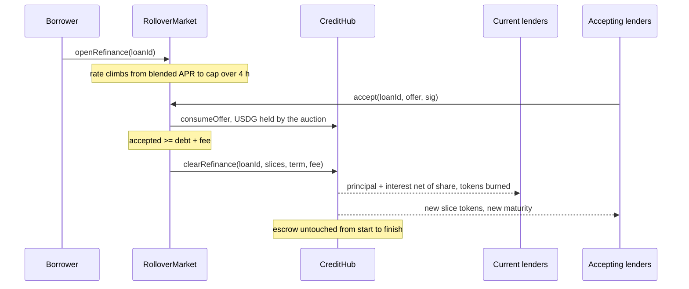

# When the term ends: grace and rollover

Every fixed term has an end date, and in most lending designs that date can cost a borrower a perfectly healthy position simply because the cash is not to hand. Spatial gives two ways through. Before maturity there is a rollover auction; after it, a grace period. The auction follows the Blend pattern and discovers just one number, the rate, which means no price feed, no keeper discretion and no governance vote play any part. When not a single lender will take the position at a rate under the cap, that is the market's verdict, and the loan moves to liquidation.

## Before maturity: rolling the loan

### Starting a rollover

A rollover starts when the borrower calls `openRefinance(loanId)`, a function on `RolloverMarket`. The hub checks three things: the caller is the borrower, `maturity` still lies ahead, and the loan status is Active. Once a loan has entered its grace period it can no longer roll. The loan's status changes to Refinancing, and the `RefinanceOpened` event logs the starting rate, the cap and the closing time.

### How the rate moves

* The auction starts at the loan's blended APR, meaning the average of its live slices' rates weighted by principal.
* From there it rises linearly until it reaches the starting rate plus `capSpreadBps`. `RiskConfig` sets that spread to 400 basis points by default, over a four-hour window.
* Anyone can read the live rate from `currentRate(loanId)`.

### Taking part

Lenders fund some or all of a rollover by calling `accept(loanId, offer, signature)` with a signed lend offer. The offer's `aprBps` has to be no higher than the current rate, and the slice is recorded at the current rate, not at the offer's figure, so lenders who come in at different points end up on different rates. The offer also has to match the loan. It must be a lend offer. Its collateral field must hold either the token backing this loan or the sentinel address for that token's tier. Term and loan token must be identical to the loan's. Its `maxLtvBps` cannot sit below the LTV the loan has now, and its `requestId` must be zero or match the rollover key for this loan. Its maker must hold a lender role.

Each acceptance fills whichever is smaller: what the offer still has available, or what the auction still needs to hit its target. The USDG moves at the point of acceptance, taken from the maker's wallet or, for a park-flagged offer, from the parked vault. It waits in the auction contract until the auction either clears or unwinds.

Submission is open to any address. A lender can therefore sign at the lowest rate they would accept and leave a keeper or relayer to post it once the rising rate reaches that level. Existing lenders frequently roll their own slices like this.

### When the auction clears

`target(loanId)` is the sum of principal, the interest due at that instant and a refinance fee equal to 0.10% of principal. As interest continues to accrue, the target edges higher over the window. The `accept` call that brings accepted funds up to the target also clears the auction:

1. The auction passes the USDG to the hub and calls `clearRefinance`.
2. The hub pays the old slices out in full, principal plus interest minus the 10% share, and burns their slice tokens.
3. The borrower is charged the fee, which goes to the FeeVault. The [fees page](fees.md) lists it with the rest.
4. The loan begins again on a term of the same length, starting from the clearing block. Principal is reset to the previous debt with the fee added, and neither comes out of the borrower's wallet.
5. Fresh slice tokens are minted to each acceptor at the rate they accepted.
6. The health factor is checked against the new principal. If it is under 1.0, the entire call reverts with `Unhealthy`.

The collateral never leaves escrow. During the auction the borrower may call `addCollateral` to raise the health factor ahead of that check, but `repay` stays unavailable until the auction has either cleared or been withdrawn.

### When it falls short, or the borrower pulls out

Should the window close below target, any address can call `fail(loanId)`. Every acceptor gets a refund, the capacity they used returns to their offers, and the hub sets the loan to Defaulted. Repayment and top-ups still work on a Defaulted loan, but its collateral can be auctioned whatever the health factor.

Up until the moment it clears, the borrower can call off a rollover with `cancelRefinance(loanId)`, even if lenders have already accepted. Those acceptors are refunded in USDG and the loan goes back to Active with its original terms. If a liquidation auction opens while a rollover is running, the rollover is cancelled in the same way.

## After maturity: the grace period

Once `block.timestamp` moves beyond `maturity`, a grace period of 24 hours begins (`graceWindow` in `RiskConfig`). During it:

* the borrower can still `repay` and get the collateral back,
* each slice goes on accruing at its own APR,
* a health factor below 1.0 can still trigger a liquidation auction, exactly as before maturity.

Once the grace period is over, an unpaid loan counts as past grace. Its status remains Active, `isPastGrace(loanId)` on `LiquidationAuction` returns true, and any address can start an auction on it regardless of health factor. The borrower can keep repaying until that happens. The next steps are set out on the [liquidation auction page](health-and-auctions.md).

## Example

Consider a loan of 20,000 USDG with a blended rate of 8.825% and three days left. The borrower starts a rollover, whose rate would top out at 12.825% at the four-hour mark. Roughly 35 minutes in, the rate stands at 9.4%. Two existing lenders plus one newcomer accept, and between them they fund the 20,150.56 USDG target, which breaks down as principal of 20,000, 130.56 of interest covering 27 days, plus the 20 USDG fee. The old slices are paid their 27 days of interest. At 9.4%, three replacement slice tokens are issued against 20,150.56 of principal, with a fresh 30-day term, and the collateral stays in escrow the whole time.
