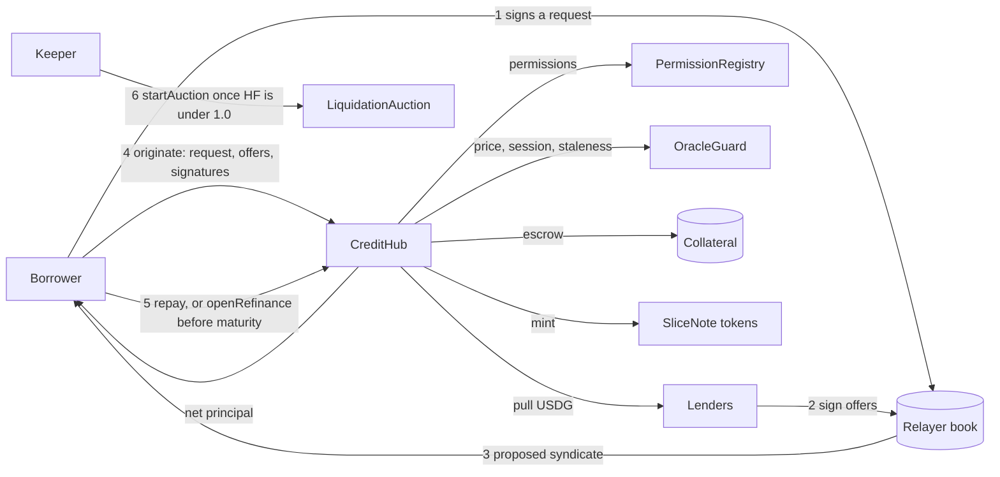

# How Spatial works, end to end

Begin with what Spatial leaves out. There is no lending pool here. No lender deposits USDG into a shared balance, and no utilisation curve sets the price of credit. Instead the protocol is built from three pieces: an open book of signed messages, a single hub contract that turns signed messages into loans, plus a small set of roles. Each action any role takes is recorded on chain, and you can inspect all of it at `/platform/explorer`, home of the public [Explorer](../guides/explorer.md).

## Objects the hub works with

Five kinds of object appear in the contracts.

**Borrow request.** The borrower's signed description of the loan they are after. A relayer stores it, a targeted offer refers to it by hash, and that hash is consumed by the hub when the request is filled.

**Lend offer.** The `LendOffer` a lender signs as EIP-712 typed data. Each of its fields is explained in [Offers, requests and origination](offers-and-origination.md).

**Market.** A tuple of `(collateralToken, loanToken, oracle, ltvConfig)`. Markets are isolated from one another. One Stock Token can sit in several markets, each pairing it with a different loan asset and parameter set, and a problem in any one of them stays inside it.

**Loan.** What the hub writes when a loan originates: a single borrower, a single collateral escrow, and at least one slice.

**Slice.** The share of a loan that belongs to one lender, represented by a slice token. For how shares are calculated, read [Syndicates and lender slices](syndicates.md).

## The four roles

| Role     | Who may act                                                                                                       | Responsibilities                                                                                                                                                                        |
| -------- | ----------------------------------------------------------------------------------------------------------------- | --------------------------------------------------------------------------------------------------------------------------------------------------------------------------------------- |
| Borrower | Holds `BORROWER` in the `PermissionRegistry`                                                                      | Holds Stock Tokens. Signs requests to borrow, submits the origination, makes repayments, tops up collateral and starts rollovers.                                                         |
| Lender   | Holds `LENDER_PROFESSIONAL` today, or `LENDER_RETAIL` in jurisdictions that permit it                             | Signs targeted or standing offers, owns slice tokens and gets repaid pro rata to principal. May choose parked capital and may choose in-kind liquidation.                                |
| Keeper   | Needs `LIQUIDATOR` only for buying collateral in an auction; starting an auction, like every other keeper task, is open to all | Starts liquidation auctions, accepts rollover offers for lenders who delegate, issues margin alerts and rebalances parked capital. Takes a cut of each penalty.                 |
| Relayer  | Needs `RELAYER` only when submitting a transaction for someone else                                               | Stores and serves signed offers, validates them against on-chain state and proposes fills. Anyone can run one.                                                                          |

## The path from request to close

1. The borrower signs a request naming the collateral token and quantity, the principal sought, the highest APR they will accept, a term of 7, 14, 30 or 90 days, and finally a fill deadline. That deadline is called the launch window, and after it expires nobody can fill the request.
2. Lenders answer with offers they sign off chain. A targeted offer points at a single request. A standing offer points at a token or an entire tier and sits until a request with matching terms comes along.
3. The borrower has a relayer gather enough offers to reach the principal. If the relayer holds the `RELAYER` role, it may also send the origination transaction itself, attaching the request signature the borrower produced.
4. Everything else happens inside one `originate` call. The hub checks every signature and every role, values the collateral through the guard (with a closed-market haircut applied if the trading session calls for one), compares the LTV with the tier ceiling, records each offer, collects USDG from each lender, locks the collateral in escrow and issues a slice token for every fill.
5. From that block onward interest builds up per second, with every slice earning the fixed APR its lender set. Repayment is allowed whenever the borrower likes, but interest covering the minimum interest period is due regardless of how soon they pay. Ahead of maturity the borrower can instead start a rollover auction, which is the `openRefinance` call on chain.
6. If the health factor falls below 1.0, any address can call `startAuction`, which opens a Dutch auction for the collateral. The money raised is paid out in a set order: the keeper's cut of the penalty first, then what lenders are owed, then the lenders' cut of the penalty, then the protocol's cut, with any remainder returned to the borrower.

An event is emitted at every step. Only the set of unfilled offers lives off chain, and even that is open to all, built from signed messages that anybody can check, and copied by the indexer.

## Guarantees built into the design

* Lender funds are never in the protocol's hands before a match. The USDG travels straight from lender to borrower within the origination transaction.
* A loan cannot open unless a usable price exists. The single planned exception sits on the roadmap: negotiated loans against Tier D collateral, available to professional lenders alone and carrying no automatic liquidation.
* A loss is confined to whichever loan, and whichever slice, incurred it. No loss is spread over other loans.
* Nothing can pause repayment or the release of collateral after the debt is settled. Neither a guardian nor a governance key has the power to stop either one.

## Further reading

* [Loan states](loan-states.md) walks through each status transition and the flight log.
* [Health factor and auctions](health-and-auctions.md) explains the health factor and how liquidation runs.
* [The contract set](../architecture/contracts.md) describes each component deployed on chain.
